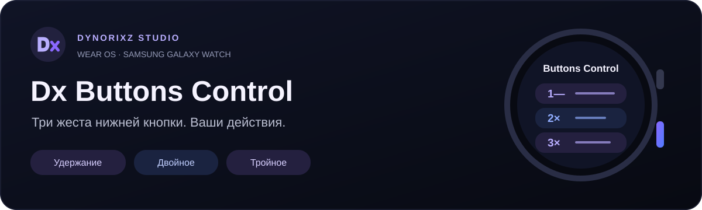

<div align="center">



**Three gestures. One lower button. Your watch, your actions.**

[Download APK](https://github.com/Dynorixz/Dx-Buttons-Control/releases/tag/v1.1.2-ultra-test) · [Русский](README.md) · [Compatibility](docs/COMPATIBILITY.md)

</div>

## What it does

Dx Buttons Control is a standalone Wear OS app by **Dynorixz Studio**. Assign supported actions to the lower physical Back button using a global hold or watch-face-only double/triple presses.

| Gesture | Scope | Default timing |
|---|---|---|
| Hold | Screen on and unlocked, wherever firmware delivers events | 650 ms |
| Double press | Confirmed watch face only | 350 ms gap; deferred to allow a third press |
| Triple press | Confirmed watch face only | Cancels the pending double action |

Observation mode passes the complete DOWN/UP sequence to Samsung, preserving the ordinary short press. No root, Shizuku, Xposed or persistent ADB connection is required.

> [!IMPORTANT]
> **1.1.2-ultra-test is a prerelease.** The narrow Samsung Galaxy Watch Ultra SM-L705 gpio_keys profile is based on supplied diagnostics and unit tests. **This APK has not yet been physically tested on the client's Ultra.** Unit tests do not prove firmware compatibility.

## Features and device status

Installed apps with icons, search, favorites and recents; public navigation/settings and standard tool intents; optional MediaSession controls; a white-screen flashlight; **DX Quick Actions** with 4–6 commands; gesture timings, vibration, app exclusions and local JSON import/export. Calibration reports show actual InputDevice metadata and explicit rejection reasons.

- **SM-L355F / pmic_resin:** all three gestures tested with debug 1.1.0; repeated double/triple presses confirmed by the user. The optimized release was not separately tested on the watch.
- **SM-L705 / gpio_keys:** profile implemented and unit-tested in 1.1.2; new-APK hardware validation pending.
- **Other Wear OS devices:** require actual key delivery, calibration and reliable watch-face detection.

The Ultra exception requires Samsung SM-L705 (optional single regional suffix), key 264, scan 580, event/device sources 0x101, a nonempty descriptor and a nonvirtual device. Generic key 264 and Home/Power remain protected. Existing pmic_resin support is preserved.

Protected Wi-Fi/Bluetooth toggles are not bypassed. Wallet/Pay and workout button handling can conflict with observation mode. Screen-off, AOD and locked-screen handling are disabled.

## Install and configure

1. Download the signed **wear-release.apk** asset from [Releases](https://github.com/Dynorixz/Dx-Buttons-Control/releases/tag/v1.1.2-ultra-test).
2. Install on the watch and enable the Dx accessibility service manually.
3. In the Russian UI open **Настройки → Кнопка и циферблат → Определить кнопку**. Press/release the lower Back button, return to Dx and confirm **«Это нижняя кнопка»**.
4. Assign vibration to Hold and test the physical button. Confirm the watch face before testing double/triple presses.
5. After the diagnostic build, repeat calibration. If rejected, export the complete **«Отчёт кнопки»** JSON.

ADB pairing and connection ports can differ:

```sh
adb pair <WATCH_IP>:<PAIRING_PORT>
adb connect <WATCH_IP>:<CONNECTION_PORT>
adb install -r dx-buttons-control-1.1.2-ultra-test-wear-release.apk
```

Release signing matches 1.1.0 and 1.1.1-diagnostics. Debug uses another certificate: export settings outside app data before uninstalling it. Settings import deliberately clears hardware bindings.

## Build and privacy

JDK 17, Android SDK platform **37.0**, Build Tools 36.0.0, Gradle Wrapper 9.3.1 and AGP 9.1.1. Minimum API 30; target API 36.

```sh
./gradlew :core:test :app:assembleDebug :app:lintDebug --max-workers=1 --console=plain
```

Windows: use `gradlew.bat`. Release signing uses an external properties file via `-PdxReleaseSigningFile`; [build instructions](docs/BUILDING.md). Private signing material is never included.

**169 JVM tests** passed in the last local logic verification. Release build and lint passed (0 errors, 14 warnings); signature and alignment verified. [Evidence and limitations](VERIFICATION.md).

No INTERNET permission, analytics, server, password/contact/message collection, foreground service or recurring polling. Accessibility reads bounded window metadata and physical key fields. Reports stay local unless the user exports them. [Privacy](docs/PRIVACY.md).

[Architecture](docs/ARCHITECTURE.md) · [Changelog](CHANGELOG.md) · [Contributing](CONTRIBUTING.md) · [Issues](https://github.com/Dynorixz/Dx-Buttons-Control/issues/new/choose)

**Dynorixz Studio** · [Telegram](https://t.me/dynorixz) · [GitHub](https://github.com/Dynorixz) · [Support](https://pay.cloudtips.ru/p/5d56061d)

© 2026 Dynorixz Studio. A separate source reuse license has not been selected.
