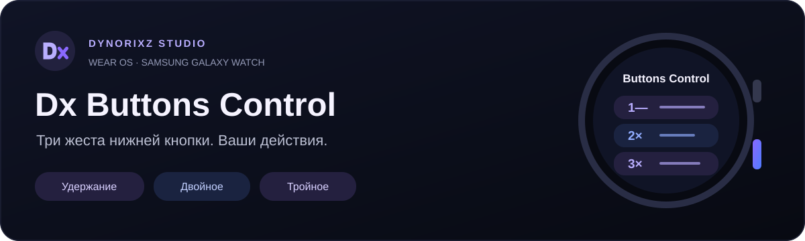
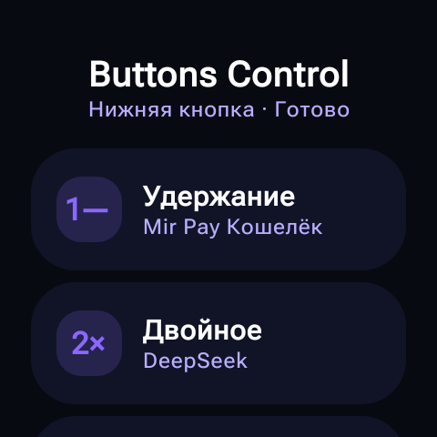
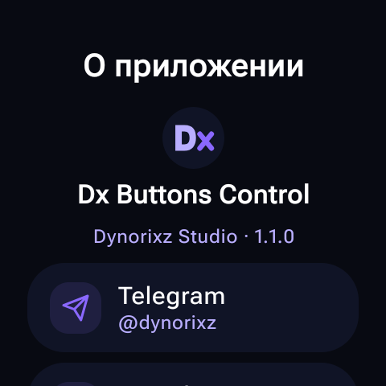

<div align="center">



**Три жеста нижней кнопки. Ваши действия на часах.**

[](docs/COMPATIBILITY.md)
[](docs/BUILDING.md)
[](https://github.com/Dynorixz/Dx-Buttons-Control/actions/workflows/android.yml)
[](https://github.com/Dynorixz/Dx-Buttons-Control/releases)

[**Скачать APK**](https://github.com/Dynorixz/Dx-Buttons-Control/releases/tag/v1.1.2-ultra-test) · [Установка](docs/INSTALLATION.md) · [Совместимость](docs/COMPATIBILITY.md) · [English](README.en.md)

</div>

## Управление, которое всегда под рукой

**Dx Buttons Control** — приложение Dynorixz Studio для автономных часов Wear OS. Назначайте нижней физической кнопке Back запуск приложений, системные команды, музыку или собственное меню DX Quick Actions. Интерфейс рассчитан на круглый экран; настройки хранятся на часах.

| Жест | Где работает | Поведение |
|---|---|---|
| **Удержание** | На включённом, разблокированном экране, где прошивка передаёт события | Одно действие после порога; по умолчанию 650 мс |
| **Двойное** | Только на подтверждённом циферблате | Ожидает третьего нажатия; интервал по умолчанию 350 мс |
| **Тройное** | Только на подтверждённом циферблате | Выполняет тройное действие, отменяя отложенное двойное |

Обычное короткое нажатие в режиме наблюдения сохраняет поведение Samsung. Root, Shizuku, Xposed и постоянное подключение ADB не требуются.

> [!IMPORTANT]
> **Текущий выпуск — предварительный `1.1.2-ultra-test`.** Профиль нижней кнопки Ultra SM-L705 добавлен по фотографиям аппаратной диагностики и покрыт unit-тестами. **Новый APK ещё не проверен физически на часах клиента.** Подробности — в [отчёте о профиле Ultra](docs/ULTRA_GPIO_PROFILE_1.1.2.md).

## Интерфейс

<div align="center">

&nbsp;&nbsp;

</div>

Реальные снимки интерфейса версии 1.1.0 с Samsung SM-L355F. В 1.1.2 обновлены аппаратный профиль и диагностика; эти изображения не подтверждают испытаний на Ultra.

## Возможности

- **Приложения:** поиск, иконки, избранное, 12 недавних выборов, проверка доступной Activity перед запуском.
- **Навигация:** циферблат, Back, уведомления, быстрые настройки, недавние и список приложений — если прошивка предоставляет системное действие.
- **Инструменты:** таймер, будильник, календарь, диктофон, помощник, экранный фонарик и разрешённые ярлыки. Секундомер и поиск телефона выбираются как приложения.
- **Музыка:** Play/Pause, следующий и предыдущий трек через MediaSession; отдельный экран управления.
- **Система:** экраны Wi-Fi, Bluetooth, звука и дисплея; яркость и DND при выданном доступе. Защищённые сетевые переключатели напрямую не меняются.
- **DX Quick Actions:** 4–6 закреплённых команд, крупные круглые кнопки, touch и вращение рамки/rotary.
- **Персонализация:** отдельное действие и вибрация для каждого жеста, интервалы, исключения приложений, JSON экспорт/импорт.
- **Диагностика:** фактические поля InputDevice, причины отклонения, обнаруженный жест, результат команды и локальный JSON отчёт.

## Проверенная совместимость

| Устройство / сценарий | Статус |
|---|---|
| **Samsung SM-L355F**, `pmic_resin`, 264 / scan 580 | Три жеста проверены в debug 1.1.0; пользователь подтвердил повторные двойные и тройные без пропусков. Оптимизированный release отдельно на часах не испытывался |
| **Galaxy Watch Ultra SM-L705**, `gpio_keys`, 264 / scan 580 | Узкий профиль 1.1.2 подготовлен по фото и модели; аппаратная проверка нового APK ожидается |
| Другие Wear OS часы | Условная совместимость: нужна доставка событий, успешная калибровка и подтверждение циферблата |
| AOD, выключенный экран, блокировка | Обработка отключена |

Для Ultra проверяются Samsung / семейство SM-L705, `event.source = InputDevice.sources = 0x101`, непустой descriptor, `isVirtual=false` и согласованная пара DOWN/UP. Сам код 264 без аппаратного профиля не разрешён. Home/Power защищены; прежнее правило `pmic_resin` сохранено.

Wallet/Pay и тренировки могут использовать ту же кнопку. Dx не отменяет закрытую политику Samsung. В режиме наблюдения системное действие может выполниться одновременно; если оно уводит с циферблата, многократный жест отменяется. [Ограничения и публичные API →](docs/COMPATIBILITY.md)

## Быстрый старт

1. Скачайте **`dx-buttons-control-1.1.2-ultra-test-wear-release.apk`** из [Releases](https://github.com/Dynorixz/Dx-Buttons-Control/releases/tag/v1.1.2-ultra-test) и установите на часы. APK для Wear OS, не для телефона.
2. Включите **«Dx · Управление нижней кнопкой»** в системных специальных возможностях.
3. В Dx откройте **Настройки → Кнопка и циферблат → Определить кнопку**. Нажмите и отпустите нижнюю кнопку, вернитесь в Dx и подтвердите **«Это нижняя кнопка»**.
4. Назначьте удержанию вибрацию и проверьте физическое нажатие. Для двойного/тройного сначала настройте циферблат и убедитесь, что он определён.
5. При отказе откройте **«Отчёт кнопки»**. Экранная проверка действия проверяет команду, а не физический жест.

[Установка по ADB, обновление и устранение проблем →](docs/INSTALLATION.md)

## Сборка и устройство проекта

Полный Android Studio проект: Kotlin, Compose for Wear OS Material 3, MVVM, DataStore. Минимальный Android — API 30, target — 36, compile SDK — 37.0; JDK 17, Gradle Wrapper 9.3.1, AGP 9.1.1.

```powershell
.\gradlew.bat :core:test :app:assembleDebug :app:lintDebug --max-workers=1 --console=plain
```

На Linux/macOS: `./gradlew :core:test :app:assembleDebug :app:lintDebug --max-workers=1 --console=plain`.

| Модуль | Ответственность |
|---|---|
| `core` | Автомат жестов, профили кнопок, калибровка, политики циферблата, действия и JVM-тесты |
| `app` | AccessibilityService, Android API, InputDevice/окна, Compose, DataStore и диагностика |
| `scripts` | Сборка, подпись release, установка и debug-перенос настроек |

[Сборка и подпись →](docs/BUILDING.md) · [Архитектура →](docs/ARCHITECTURE.md) · [Участие →](CONTRIBUTING.md)

## Проверки и приватность

Последняя локальная проверка логики: **169 JVM-тестов**, успешные `assembleRelease` и `lintRelease` — 0 ошибок, 14 предупреждений. Подпись v2 и ZIP-выравнивание APK проверены. [Полный отчёт и границы проверки →](VERIFICATION.md)

Accessibility используется для физических кнопок и ограниченных метаданных окон. Приложение не читает тексты переписок, пароли или контакты, не имеет разрешения INTERNET, аналитики, постоянного foreground service или периодического опроса. Настройки и отчёты хранятся локально; экспорт запускает пользователь. [Разрешения и приватность →](docs/PRIVACY.md)

## Документация и обратная связь

[История изменений](CHANGELOG.md) · [План испытаний на часах](docs/DEVICE_TEST_PLAN.md) · [Сообщить о проблеме](https://github.com/Dynorixz/Dx-Buttons-Control/issues/new/choose) · [Безопасность](SECURITY.md)

**Dynorixz Studio** — [Telegram](https://t.me/dynorixz) · [GitHub](https://github.com/Dynorixz) · [Поддержать проект](https://pay.cloudtips.ru/p/5d56061d)

© 2026 Dynorixz Studio. Отдельная лицензия на повторное использование исходников пока не выбрана.
