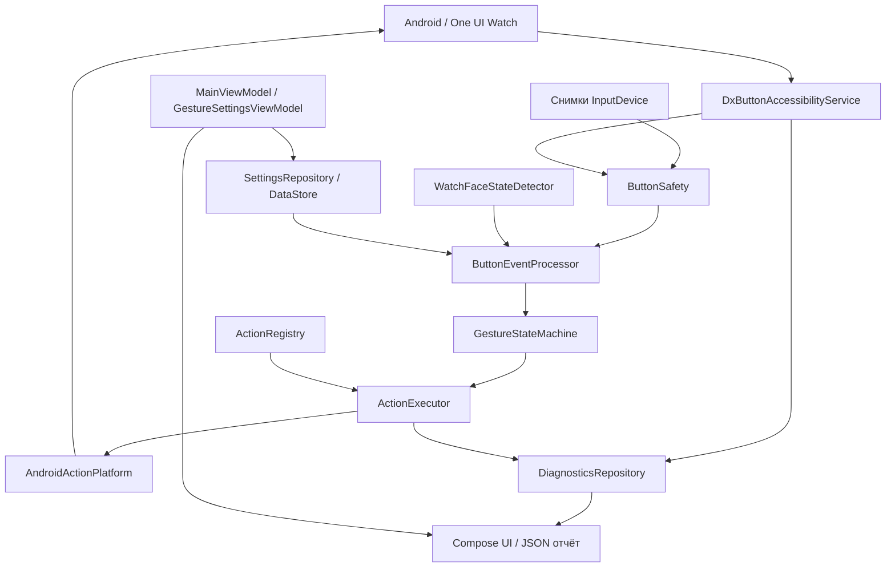

# Архитектура

Android-модуль `app` и независимый JVM-модуль `core`. MVVM отвечает за состояние интерфейса, Repository — за настройки, каталог приложений и диагностику. Обработчик кнопок не зависит от Compose.



## Путь нажатия

1. `DxButtonAccessibilityService` получает `onKeyEvent`. Копируются примитивные поля: action, key/scan/device/source, downTime/eventTime, repeat и flags.
2. `HardwareInputs` и `InputDeviceCache` отдельно обновляют метаданные. В callback нет Binder-запросов к InputDevice, обхода дерева или бесконечного ожидания.
3. `ButtonSafety` проверяет аппаратную идентичность, защищённые коды и привязку. Калибровка требует согласованной пары DOWN/UP и подтверждения пользователя. На холодном кэше после UP предусмотрено ограниченное асинхронное ожидание.
4. `ButtonEventProcessor` учитывает экран, окно, исключения и назначенные действия. `KeySequenceOwnership` сохраняет единое решение о передаче DOWN/UP.
5. `GestureStateMachine` использует монотонные timestamps. Отложенное двойное уступает третьему нажатию; удержание и смена контекста отменяют незавершённую комбинацию.
6. `ActionExecutor` проверяет действие через `ActionPlatform`, выполняет его и записывает результат. Передача Intent не подменяет подтверждение реального действия внешнего приложения.

## Определение циферблата

`WatchFaceStateDetector` получает ограниченные метаданные активного окна. HOME-пакет определяется через PackageManager, но одного package name недостаточно: нужны признаки поверхности циферблата и её видимость. Для неизвестного хоста есть подтверждаемая калибровка. При сомнении двойное/тройное запрещены. Запоздалое Accessibility-событие не отменяет более свежий авторитетный снимок активного окна.

## Хранилища и фон

- `SettingsRepository`: DataStore, проверяемый JSON схемы 1; импорт сбрасывает аппаратные привязки.
- `InstalledAppsRepository`: локальный каталог Activity, проверка enabled/exported/permission.
- `DiagnosticsRepository`: ограниченная история в памяти и последний отчёт через AtomicFile. Восстановленный отчёт не создаёт кандидата кнопки.
- `QuickActionsActivity`: запускается по требованию и не живёт постоянно в фоне.
- AccessibilityService управляется Android. Нет BootReceiver, foreground service, wake lock или периодического polling. Обновления запускаются событиями; таймеры жестов одноразовые.

## Добавление действия

Добавьте `ActionSpec` в `core/Actions.kt`, проверку доступности и реализацию в Android-адаптер. Для нестандартных аргументов добавьте валидацию. Автомат жестов менять не требуется. Для последовательностей сначала проверяются все конечные команды; выполнение останавливается при ошибке.

## Структура

```text
app/src/main/java/com/dynorixz/buttonscontrol/
  DxButtonAccessibilityService.kt  ButtonEventProcessor.kt
  HardwareInputs.kt               WatchFaceStateDetector.kt
  AndroidActionPlatform.kt        InstalledAppsRepository.kt
  SettingsRepository.kt           DiagnosticsRepository.kt
  MainViewModel.kt                ui/
core/src/main/kotlin/com/dynorixz/buttonscontrol/core/
  GestureStateMachine.kt          Models.kt / ButtonSafety
  ButtonDiagnostics.kt            InputDeviceCache.kt
  WatchFacePolicy.kt              WindowStateTracker.kt
  Actions.kt / ActionExecutor     KeySequenceOwnership.kt
core/src/test/kotlin/com/dynorixz/buttonscontrol/core/
  Unit-тесты жестов, профилей, калибровки, действий и политик
```
